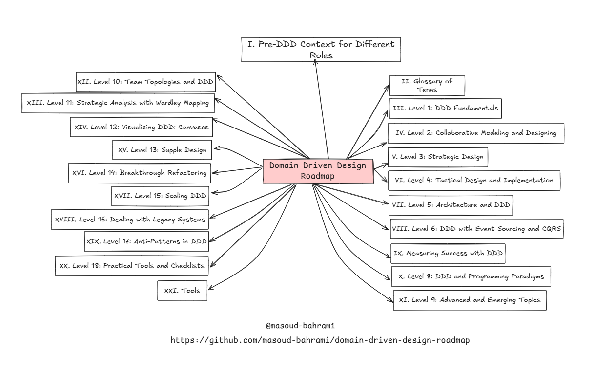

# Domain-Driven Design Roadmap

### Learn to understand the domain. Learn to model its complexity. Design software that speaks the language of the business.

Domain-Driven Design (DDD) is not a collection of patterns to apply to every software project. It is an approach to software development that puts the knowledge of the business domain at the center of design decisions.

It starts with a deceptively simple idea: **the most important part of complex software is understanding the problem it is meant to solve.**

That understanding cannot be obtained from requirements documents alone, nor can it be delegated entirely to developers, architects, or business analysts. It emerges through continuous collaboration, exploration, modeling, experimentation, and learning.

This roadmap is a practical learning resource for that journey. It brings together the ideas, concepts, practices, and architectural considerations that help software teams understand complex domains and build software models that can evolve with them.

The goal is not merely to learn DDD terminology. The goal is to develop the judgment to recognize domain complexity, ask better questions, discover meaningful boundaries, make modeling decisions, and translate those decisions into software.

---

## Start your journey

There is no single correct way to learn DDD. Your starting point depends on your experience, your role, and the kind of problems you are trying to solve.

If you are new to DDD, begin with the [learning roadmap](roadmap/README.md). It provides a progressive path from foundational ideas to strategic design, tactical modeling, implementation, and system evolution.

If you already know the fundamentals, use the [concept reference](concepts/README.md), [cheatsheets](cheatsheet/README.md), and [practices](practices/README.md) to deepen your understanding and apply specific techniques.

| I want to... | Start here |
|---|---|
| Understand DDD and learn it systematically | [The Learning Roadmap](roadmap/README.md) |
| Explore a domain and collaborate with domain experts | [Domain Exploration Practices](practices/README.md) |
| Understand strategic design and model boundaries | [Strategic Design Concepts](concepts/README.md) |
| Learn tactical patterns and domain modeling | [Tactical Design Cheatsheets](cheatsheet/README.md) |
| Understand how architecture supports DDD | [Architecture Guide](architecture/README.md) |
| Apply DDD to an existing or legacy system | [Legacy Systems and Evolution](roadmap/07-evolution-and-refactoring.md) |
| Find a definition or compare two concepts | [Concept Reference](concepts/README.md) |
| Prepare a workshop or review a model | [Checklists](checklists/README.md) |
| Find books, articles, talks, and tools | [Resources](resources/README.md) |

---

## Why Domain-Driven Design?

Software becomes difficult to design when the problem itself is difficult to understand.

Consider a business that manages orders, payments, inventory, deliveries, and customer relationships. At first, these may appear to be straightforward data structures and operations. But as the business grows, apparently simple concepts begin to carry different meanings and rules.

An order in the sales process may not be the same thing as an order in fulfillment. A customer in a billing process may have different responsibilities and attributes from a customer in customer support. A product in a catalog may not be represented in the same way as an item in inventory.

The difficulty is not necessarily the number of tables, classes, services, or endpoints. It is the complexity of the domain: the rules, decisions, relationships, constraints, exceptions, and language that make the business what it is.

When software fails to reflect that complexity, the consequences are familiar:

- Business rules become scattered across controllers, services, database procedures, and background jobs.
- Different teams use the same words but mean different things.
- Changes in one part of the system unexpectedly affect another.
- The database schema gradually becomes the domain model, whether or not it represents the business accurately.
- Developers spend more time discovering what the software actually does than implementing new capabilities.
- Architectural boundaries reflect technical layers or organizational history rather than meaningful business responsibilities.

DDD offers a way to address these problems by making domain understanding and modeling central to software design.

### What DDD helps us achieve

**A shared understanding of the business**

Developers and domain experts collaborate to establish a common vocabulary and a model that represents how the business works. This language becomes part of discussions, documentation, decisions, and code.

**Models with explicit boundaries**

Different parts of a business may require different models. DDD helps teams recognize where a model is valid, where its language changes, and how separate models should interact.

**Software that expresses business behavior**

Instead of treating software as a collection of data and CRUD operations, DDD encourages us to model meaningful concepts, business rules, decisions, and behavior.

**Architectures that reflect the domain**

Strategic design provides insight into how software responsibilities should be separated and how different parts of a system should collaborate. Those boundaries can inform modular monoliths, services, and other architectural choices.

**Continuous learning and model evolution**

A domain model is not a one-time design artifact. As the team discovers new information, the model and the software should evolve to reflect that understanding.

### When DDD is worth the investment

DDD is particularly useful when:

- Business rules are numerous, interconnected, or difficult to express.
- The business domain is evolving and new requirements frequently challenge existing assumptions.
- Different departments or teams have different perspectives on the same business concepts.
- Domain experts have essential knowledge that must be understood and translated into software.
- The cost of misunderstanding a business rule is high.
- The system is strategically important and its ability to evolve is a competitive concern.

DDD is not a universal solution. A small application with simple data-entry and retrieval requirements may not benefit from the full set of DDD practices. Introducing complex models, workshops, or architectural patterns without a corresponding domain problem can make a system unnecessarily complicated.

The important question is not whether a project uses DDD. It is whether the project has enough domain complexity to justify investing in deeper domain understanding and more deliberate modeling.

---

## The learning philosophy

This roadmap is organized around a central progression:

**Understand the domain → Explore its complexity → Discover boundaries → Build models → Implement behavior → Evolve the design.**

These activities are connected, but they are not a one-way process. Implementation often reveals gaps in understanding. Testing exposes assumptions. Conversations with domain experts challenge existing models. Changes in business strategy may require boundaries to be reconsidered.

The learning path therefore introduces concepts progressively while encouraging readers to revisit earlier ideas as their understanding improves.

### 1. Understand before modeling

Before deciding what classes, services, databases, or APIs to create, understand the business problem.

Learn how to identify domain knowledge, distinguish business complexity from technical complexity, recognize domain experts, and investigate the language people use to describe their work.

### 2. Explore the domain collaboratively

Domain knowledge is distributed among people, documents, existing systems, and everyday business activities.

Learn techniques such as Event Storming, Domain Storytelling, and Example Mapping to make that knowledge visible, discuss conflicting assumptions, and discover important business rules and events.

### 3. Make strategic design decisions

A large domain cannot always be represented by one unified model.

Learn to identify subdomains, recognize the Core Domain, define Bounded Contexts, understand relationships between models, and use Context Maps to reason about integration and collaboration.

### 4. Develop expressive domain models

Once the model boundaries are understood, learn how to represent domain behavior and rules in software.

Explore Entities, Value Objects, Aggregates, Domain Events, Domain Services, Repositories, and other tactical patterns. More importantly, learn the reasoning behind these patterns and the problems they are intended to solve.

### 5. Translate models into software

A domain model must work within an actual application.

Explore application services, persistence, transactions, validation, testing, modularity, CQRS, and the relationship between domain logic and infrastructure. Learn how to preserve the integrity of the model without turning every technical concern into a domain concern.

### 6. Design architecture around meaningful boundaries

DDD does not prescribe one architectural style.

Understand how modular monoliths, layered architecture, Hexagonal Architecture, Clean Architecture, microservices, and event-driven systems can support different domain and organizational needs.

Learn when these approaches help, when they introduce unnecessary complexity, and why a Bounded Context should not automatically become a microservice.

### 7. Evolve existing systems

Most software is not built from a blank slate.

Learn how to discover implicit models in legacy systems, introduce boundaries gradually, protect new models through Anti-Corruption Layers, use characterization tests, and refactor toward deeper domain insight.

### 8. Explore advanced and complementary topics

After developing a solid understanding of DDD, explore subjects that can complement it in particular contexts.

These include Event Sourcing, advanced CQRS, Functional DDD, Domain-Specific Languages, Team Topologies, Wardley Mapping, Data Mesh, and other related approaches.

Not all of these topics are DDD itself, and none should be treated as a mandatory prerequisite. They are included because they can provide useful perspectives when the domain, architecture, or organization calls for them.

---

## The roadmap at a glance

The following map represents the recommended learning sequence. Each stage builds on the previous one, but the journey is iterative rather than strictly linear.

| Stage | Focus | What you should be able to do |
|---|---|---|
| 01 | DDD Foundations | Explain the purpose, principles, and scope of DDD |
| 02 | Domain Exploration | Discover domain knowledge and model business processes collaboratively |
| 03 | Strategic Design | Identify subdomains, Bounded Contexts, and relationships between models |
| 04 | Tactical Design | Design expressive domain models using DDD building blocks |
| 05 | Implementation and Testing | Implement domain behavior and verify business rules |
| 06 | Architecture and Integration | Choose appropriate architectural and integration approaches |
| 07 | Evolution and Refactoring | Improve existing models and systems incrementally |
| 08 | Advanced Topics | Explore specialized techniques and complementary disciplines |

For the detailed sequence, learning objectives, exercises, and recommended resources, see the [complete learning roadmap](roadmap/README.md).

---

## DDD is more than a set of patterns

One of the most common mistakes when learning DDD is to start with tactical patterns.

Developers discover Entities, Value Objects, Aggregates, Repositories, and Domain Events. They begin applying these patterns in their applications and assume they are practicing DDD.

But knowing how to implement an Aggregate does not mean knowing where an Aggregate should exist. Knowing how to create a Bounded Context does not mean knowing where a meaningful boundary belongs. Knowing how to publish an event does not mean knowing which business occurrence deserves to become an event.

Patterns are useful, but they are not the starting point.

DDD requires a deeper understanding of the relationship between the business domain, the model, the language, the software, and the people who develop it.

This distinction is important throughout the roadmap:

- **Strategic Design** helps us reason about the domain, its boundaries, and the relationships between models.
- **Tactical Design** helps us express domain concepts and behavior within a model.
- **Collaborative Practices** help us discover and validate domain knowledge.
- **Software Architecture** provides structures for implementing and integrating models.
- **Continuous Refactoring** keeps the software aligned with the understanding of the domain.

These dimensions reinforce one another. None should be mistaken for the entirety of DDD.

---

## How to get the most out of this roadmap

Reading about DDD is useful, but understanding it requires practice.

For each stage, try to work with a domain that has enough complexity to make modeling decisions meaningful. An online store, transportation company, insurance business, financial platform, or healthcare organization can all provide useful learning scenarios.

Do not try to model the entire business at once. Choose a business capability or process and investigate it.

For every topic, use the following learning cycle:

1. **Read:** Understand the concept, its motivation, and the problem it addresses.
2. **Observe:** Look for the concept in a real business or an existing software system.
3. **Discuss:** Compare your understanding with other people, especially those with domain knowledge.
4. **Model:** Represent what you have learned through language, examples, diagrams, or code.
5. **Challenge:** Look for exceptions, conflicting rules, alternative interpretations, and cases your model cannot explain.
6. **Implement:** Translate the model into software where appropriate.
7. **Reflect:** Review what worked, what did not, and what your implementation revealed about the domain.

A useful model is not one that looks elegant in a diagram. It is one that helps people reason about the business and helps developers make better decisions.

### Use a real domain whenever possible

If you have access to a real business, use it. Talk to people who understand the work. Observe how decisions are made. Investigate exceptions and disagreements.

If you do not have access to a real domain, choose a sufficiently rich example and make its assumptions explicit. Avoid exercises that reduce the business to a few database tables and straightforward CRUD operations.

### Do not rush to architecture

A common temptation is to begin by deciding whether the system should use microservices, a modular monolith, CQRS, or Event Sourcing.

Those decisions may eventually matter, but they should be informed by domain understanding and the system's constraints.

First understand what the business does, where its models differ, which capabilities matter, and how the parts need to collaborate. Then evaluate architectural options.

### Keep the model open to change

Your first model will probably be incomplete. That is expected.

DDD is not about discovering a perfect model in a workshop and implementing it forever. It is about developing a model that becomes more useful as the team learns more about the domain.

---

## Who is this roadmap for?

DDD is a collaborative approach, not an activity reserved for software developers.

This roadmap is primarily intended for people who design, build, evolve, or contribute to complex software systems.

**Software Developers and Engineers**

Learn to translate domain concepts into expressive code, design meaningful boundaries, model business behavior, and avoid treating the database as the source of the domain model.

**Software Architects and Technical Leads**

Learn to connect strategic domain decisions with software architecture, identify appropriate boundaries, manage integration, and guide systems toward structures that can evolve.

**Product Managers and Business Analysts**

Learn how domain exploration, shared language, examples, and models can improve collaboration and help teams discover the actual rules and constraints behind business requirements.

**Domain Experts and Business Stakeholders**

Understand how your knowledge contributes to the model, how terminology affects software design, and how collaborative techniques can make business rules explicit.

**UX and Product Designers**

Understand how domain language, business capabilities, and context boundaries influence user journeys, information architecture, and interactions.

You do not need to master every technical pattern to contribute meaningfully to DDD. Different roles participate at different levels, but they benefit from developing a shared understanding of the domain.

---

## How the repository is organized

The repository separates the learning path from reference material and practical techniques. This is intentional: learning a concept, looking up a definition, preparing a workshop, and choosing an architectural approach are different activities.

| Directory | What it contains |
|---|---|
| [`roadmap/`](roadmap/README.md) | The progressive learning journey, stage objectives, exercises, and milestones |
| [`concepts/`](concepts/README.md) | Detailed explanations of DDD terminology and foundational concepts |
| [`practices/`](practices/README.md) | Collaborative domain exploration, modeling, and design techniques |
| [`cheatsheet/`](cheatsheet/README.md) | Concise comparisons, decision prompts, and implementation reminders |
| [`architecture/`](architecture/README.md) | Architectural styles and integration approaches that can support DDD |
| [`checklists/`](checklists/README.md) | Practical checklists and reusable prompts for workshops and reviews |
| [`resources/`](resources/README.md) | Curated books, articles, talks, videos, tools, and communities |

The same concept may appear in several places, but with a different purpose. A concept page explains the idea in depth; a cheatsheet helps you recall it; a practice page shows how to work with it.

---

## A note on scope and interpretation

This repository is based on the author's learning, experience, and interpretation of DDD literature and software development practice.

It is a learning aid, not an official specification or a definitive account of every DDD idea. DDD has evolved through books, articles, community discussions, and practical experience. Some concepts have different interpretations, and some practices are more context-dependent than others.

To keep the material useful and intellectually honest, the roadmap distinguishes between:

- **Core DDD concepts:** Ideas directly associated with Domain-Driven Design, including Ubiquitous Language, Bounded Contexts, strategic design, and tactical modeling.
- **Complementary practices:** Techniques that help teams explore, discuss, and validate domain knowledge.
- **Architectural approaches:** Structures and patterns that may support DDD implementations but are not prescribed by DDD.
- **Adjacent disciplines and specializations:** Related topics that offer useful perspectives but are not prerequisites for practicing DDD.

Recommendations should always be evaluated against the domain, the people involved, the organization's constraints, and the actual problems being addressed.

The objective is not to follow a methodology mechanically. It is to develop the judgment to make better design decisions.

---

## About this project

This roadmap has grown from an ongoing effort to understand, organize, and connect the ideas that make Domain-Driven Design useful in real software development.

It reflects the belief that software design is deeply connected to how we understand and describe the world we are building software for. Models are not merely technical structures. They are expressions of knowledge, decisions, and shared understanding.

The material will continue to evolve as new insights, examples, resources, and contributions emerge.

If you find an explanation unclear, disagree with an interpretation, have a better example, or know a valuable resource that should be included, contributions are welcome.

See [CONTRIBUTING.md](CONTRIBUTING.md) for guidelines.

If this roadmap helps you learn or apply DDD, consider giving the repository a star. It helps other people discover the material and encourages continued improvement.

**Start learning:** [Open the DDD Learning Roadmap](roadmap/README.md)